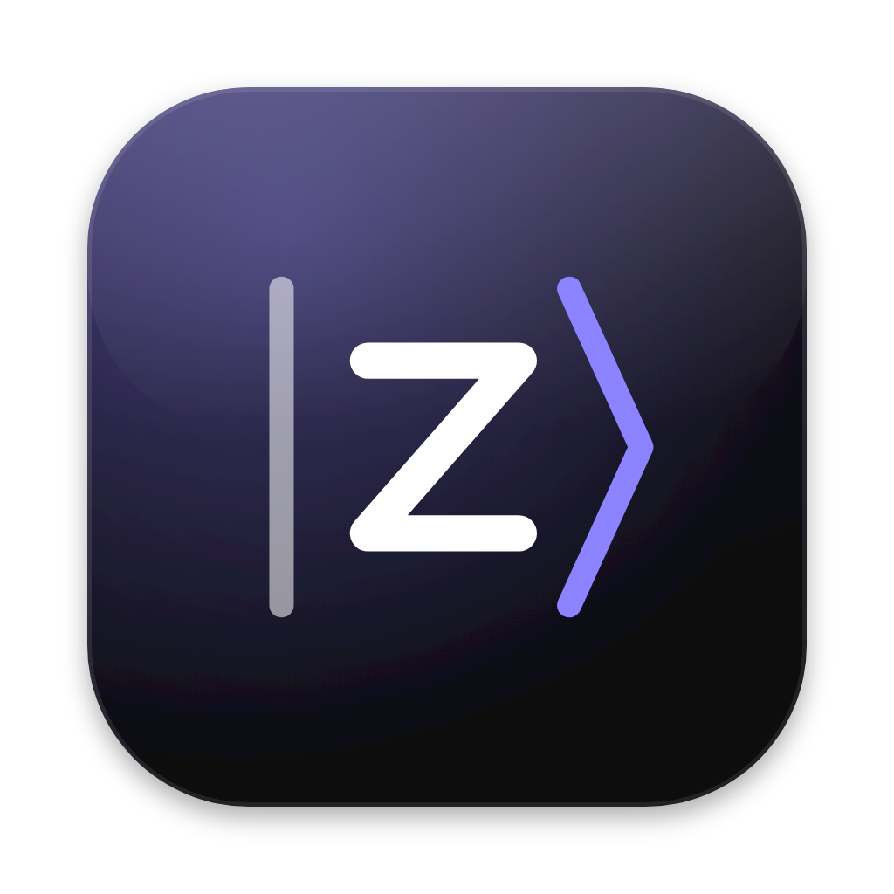

<div align="center">



# Zitter

**A browser for people who miss what browsing could feel like.**

Spaces. A sidebar that makes sense. Room for the web.

[](LICENSE)
[](#project-status)
[](chromium/revision.json)
[](#under-the-hood)

[Why Zitter](#why-zitter) · [Features](#built-around-your-spaces) · [Build](#build--explore) · [Under the hood](#under-the-hood)

</div>

---

## Why Zitter

Zitter is deeply inspired by **[Arc](https://arc.net)** and **[Zen](https://zen-browser.app)**: the sidebar, the spaces, and the care that makes a browser feel personal.

Seeing Arc lose active development was heartbreaking. With its [shutdown announced for December 22, 2026](https://arc.net), that loss feels even more real. Zitter was born to fill that gap — to keep building on the ideas that made Arc worth caring about.

An independent, open-source browser built on Chromium, with its own interface and its own path forward.

## Built around your spaces

| | The idea |
| :--- | :--- |
| **Workspaces & profiles** | Separate contexts, colors and tabs. Assign distinct profiles to keep cookies and logins apart. |
| **Vertical tabs & pins** | Keep everyday sites close, organize them in nested folders, resize or hide the sidebar. |
| **Split View & Peek** | Work with two pages side by side or stacked. Preview a link without leaving your page. |
| **Command Center** | Find tabs, pins, spaces, history and actions from the keyboard. Customize shortcuts and search engines. |
| **Time Machine** | Save workspace layouts, recover closed tabs and restore snapshots. Sleep spaces until you need them. |
| **Bring your Arc along** | On macOS, import Arc spaces, favorites, nested pins and emoji. Chrome, Edge and Brave imports are supported too. |
| **Optional AI assistant** | A pinnable right panel with per-session models, explicit browser-data grants, tab mentions, browser actions and parallel web research. Supports Codex SDK, Claude CLI, OpenAI API and local Ollama. See [setup and privacy](docs/ai-assistant.md). |
| **Built-in ad blocking** | EasyList and EasyPrivacy through Brave's adblock-rust, with no extension: blocked requests never leave the browser, a toolbar shield counts them and switches a site off, and the assistant writes rules for sites the lists miss, with a preview and your consent. See [design and licenses](docs/ad-blocking.md). |

Ctrl+T and Ctrl+K share the Command Center. When text is entered, the first result
always opens the typed address or searches in a new tab; existing tabs and pins
require an explicit arrow or mouse selection. Use `>` for commands. Matching
commands learn from your selections using frequency and a seven-day half-life,
so recent habits gradually replace older ones. Command IDs and workspace targets
are stored locally in `ZitterTools.json`; typed queries and page URLs are not
part of this command history.

A pinned tab's context menu can unpin it, edit its saved starting URL, or return
to that URL with **Back to Pinned URL**. Editing the saved URL keeps the current
page open. An active pin remains visible beneath a collapsed folder; its revealed
shortcut also remains available when you temporarily select an ordinary tab.
Domain routing menu items name the domain and destination workspace explicitly.

Light, dark and system themes. Workspace accents. Native preferences, history and downloads.

Shift-click a link to open **Peek**, then move it into a regular tab without reloading. In **Settings → Appearance**, you can disable this gesture or enable **Magic image previews**: hover over a direct image link (`.png`, `.jpg`, `.jpeg`, `.gif`, `.webp`, `.avif`, `.bmp`, `.ico` or `.svg`) for a small, passive preview. Image previews are off by default and may fetch the image before you click. Both settings apply across the app.

> **Spaces organize. Profiles isolate.** Spaces using the same profile share cookies and logins. Time Machine restores tab layouts and URLs, not page contents or unsaved forms.

## Project status

**Under active development.** Zitter is built and tested on **macOS (Apple Silicon)** and **Windows 10/11 (x64)**. On Windows the full browser UI suite passes, and Zitter ships with its own installer, Snap Layouts, a jump list, link handoff from other apps, a first-run wizard and native notifications. Linux has a bootstrap target but has not been validated.

Builds are local development apps. A notarized/signed installer and an update channel are not configured yet. Full Chrome feature and extension compatibility is not claimed.

## Build & explore

Zitter builds against the **pinned Chromium revision** in [`chromium/revision.json`](chromium/revision.json), using a dedicated checkout and Zitter's source overlay. Building the browser requires Chromium's platform toolchain and a substantial checkout.

For an already configured macOS Rust UI development checkout:

```sh
./build.sh --run
```

This helper requires the existing `zitter_ui_lab` overlay, `out/ZitterOptimized` build configuration and local signing setup. It packages `build/ZitterRustMetal.app` and launches it with an isolated profile.

<details>
<summary><strong>Windows (x64)</strong></summary>

Needs Visual Studio 2026 Build Tools (C++ desktop + ATL/MFC), the Windows 11 SDK 10.0.28000 and about 150 GB free. With the Chromium checkout in `.chromium/src` (see [docs/windows-port.md](docs/windows-port.md#phase-0-environment)):

```powershell
$env:DEPOT_TOOLS_WIN_TOOLCHAIN = '0'
python tools/install_chromium_overlay.py .chromium/src
cd .chromium/src
mkdir out/ZitterWinRelease; copy ../../chromium/windows-release.args.gn out/ZitterWinRelease/args.gn   # windows-official.args.gn: ThinLTO + PGO
gn gen out/ZitterWinRelease
autoninja -C out/ZitterWinRelease zitter zitter_setup
cd ../..
python tools/package_win.py --out .chromium/src/out/ZitterWinRelease --setup .chromium/src/out/ZitterWinRelease/zitter_setup.exe --destination build/release
```

This produces a portable package and `Zitter-<version>-win-x64-setup.exe`, which installs per user or for all users and supports `--quiet`.

</details>

<details>
<summary><strong>Explore the core without building Chromium</strong></summary>

The workspace model and controller build independently with CMake and a C++20 compiler. This runs their contract tests; it does not build the browser.

```sh
cmake -S . -B build/core -DCMAKE_BUILD_TYPE=Debug
cmake --build build/core --config Debug
ctest --test-dir build/core -C Debug --output-on-failure
python3 tools/check_boundaries.py
```

</details>

## Under the hood

**Chromium** handles the web. **Rust** owns Zitter's UI models, layout and interaction logic. **C++ and Views adapters** connect them to browser services, native windows, input and accessibility. The default rendering path uses Chromium's compositor; an optional Metal backend is available on macOS.

The [product/browser boundary](docs/product-browser-boundary.md) describes the
standalone workspace, command-ranking and pin-tree logic, shared UI data models,
and the responsibilities retained by the Chromium adapters.

## Contributing

Bug reports and focused pull requests are welcome. Include your platform, build revision and reproduction steps. For UI changes, add screenshots; for performance claims, include the measurement method.

[Report an issue](https://github.com/doctorspider42/zitter/issues) · [Open a pull request](https://github.com/doctorspider42/zitter/pulls)

## License & credits

Original Zitter code is licensed under **[Apache 2.0](LICENSE)**. Third-party code keeps its own licenses; see [NOTICE](NOTICE).

With gratitude to Arc and Zen for the inspiration, and to Chromium and the open-source projects underneath.
