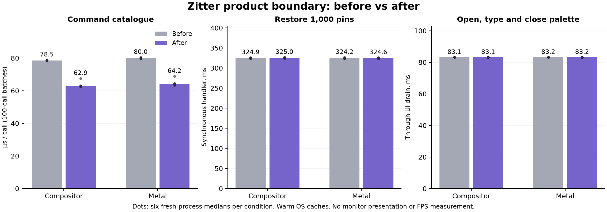

# Product boundary: measured UI performance

The extraction improves command catalogue generation by about 20%, saving roughly
16 microseconds per call in the expanded-workspace fixture. It does not produce
a measurable improvement in ordinary tab, folder-toggle or palette completion
times. Large catalogue updates remain dominated by native view hierarchy changes,
layout and, on the compositor backend, text painting.

These results freeze the product before integrating the subsequent assistant and
ad-blocking changes from `main` (`d51f69d`). The later local macOS build includes
that merge; these measurements must not be presented as a before/after comparison
of those additional features.



## Method and scope

- Apple M3 Pro, 12 CPU cores, 36 GiB RAM, macOS 27.0.1. Other desktop applications
  remained running. Background load was recorded locally rather than stopping
  the user's applications.
- Before: `b18548b`, the parent of the uncommitted extraction. After: the product
  changes described in [the boundary document](product-browser-boundary.md).
  Both use the same pinned Chromium, SDK, compiler, non-component Release output,
  ThinLTO and Chromium PGO settings.
- Six fresh-process repetitions per version and raster backend, alternating
  version/backend order. Each process uses private test fixtures and three
  excluded warmup iterations. OS caches remain warm. No compilation or profiling
  ran concurrently with a measured comparison.
- Ordinary interaction: 20 local tabs, one folder, 40 measured iterations per
  process. Actual sidebar selection, folder collapse/expand and palette editing
  are invoked programmatically through their existing controls. There are
  24 processes and 8,640 retained timing samples.
- Product stress case: 1,000 pins, a child-before-parent catalogue with 32 folder
  levels, eight additional workspaces and seeded command usage. Each of 20
  measured iterations generates the command catalogue in a 100-call batch,
  restores the pins, reparents their root and deletes that subtree. The public
  browser APIs and benchmark source are identical on both versions. Assertions
  verify catalogue sizes and successful operations. There are 24 processes and
  3,360 retained timing samples. This is a synthetic stress case, not an average
  browsing session.

The ordinary comparison reuses the verified existing binaries: all 97 baseline
product/core source files match `b18548b`, after normalizing the testdata prefix,
and no source is newer than its binary. The stress binaries were rebuilt from
frozen baseline/current sources with the same new benchmark. Only five adapter
sources, five added core files and their GN declarations differ; the common test
source hash is recorded. Exact binary, source and build-argument evidence is in
the [machine-readable summary](benchmarks/product-boundary-ui-2026-11-05.json).

Times below are medians of six process medians. Changes and descriptive 95%
bootstrap intervals use paired process results, not pooled correlated iterations.
Consequently a change column need not equal the ratio of the two displayed
medians. All measured samples were retained. Intervals are descriptive for this
machine and do not apply a multiple-comparison correction.

**Endpoints matter:** synchronous dispatch measures work inside the operation;
settled completion additionally waits for persistence and drains posted UI/layout
work. Neither measures physical input-to-photon latency or FPS. An event-loop
wait can continue pumping other events; an 83 ms drained palette cycle does not
mean an 83 ms synchronous freeze. The 325 ms restore handler, however, is actual
synchronous work on the browser's UI thread.

## Ordinary interaction

| Operation / endpoint | Compositor before → after, ms | Metal before → after, ms | Interpretation |
|---|---:|---:|---|
| Select tab, through UI drain | 16.598 → 16.598 | 16.595 → 16.595 | No detected change |
| Toggle folder, through UI drain | 16.686 → 16.686 | 16.672 → 16.674 | No detected change |
| Open palette, synchronous call | 9.312 → 9.253 | 8.979 → 9.042 | Paired intervals include zero |
| Open, type, close palette, through UI drain | 83.146 → 83.147 | 83.173 → 83.178 | No detected change |
| Whole iteration, through UI drain | 116.663 → 116.661 | 116.668 → 116.670 | No detected change |

Tab-selection pooled p95 is approximately 16.67 ms in all conditions. Palette-cycle
p95 remains approximately 91.5 ms. These completion times cluster around the
event/display scheduling cadence; they cannot resolve a small computational
improvement as a physical responsiveness gain.

Browser CPU per iteration is 46.60 → 46.88 ms with the compositor and 43.57 →
43.80 ms with Metal. Post-workload browser physical footprint is 116.8 → 116.9 MiB
and 263.7 → 263.1 MiB respectively. There is no useful CPU or memory saving from
the extraction in this workload. Footprint excludes renderer, GPU and WindowServer
processes; it is not total browser RAM.

## Expanded catalogue and pin stress

| Operation / endpoint | Compositor before → after | Paired change, 95% interval | Metal before → after | Paired change, 95% interval |
|---|---:|---:|---:|---:|
| Command catalogue, mean call within 100-call batches | 78.5 → 62.9 µs | −20.0% [−20.3%, −17.0%] | 80.0 → 64.2 µs | −19.8% [−20.5%, −16.7%] |
| Restore pins, synchronous dispatch | 324.89 → 325.00 ms | +0.07% [−0.24%, +0.74%] | 324.23 → 324.56 ms | +0.03% [−0.58%, +0.51%] |
| Restore pins, settled completion | 458.79 → 460.34 ms | +0.34% [+0.33%, +1.18%] | 350.36 → 351.98 ms | +0.48% [−0.72%, +1.59%] |
| Reparent subtree, synchronous dispatch | 144.42 → 144.93 ms | +0.35% [−0.02%, +0.65%] | 144.49 → 144.74 ms | +0.34% [−0.60%, +0.72%] |
| Reparent subtree, settled completion | 275.00 → 275.01 ms | Approximately zero | 175.00 → 175.00 ms | Approximately zero |
| Delete subtree, synchronous dispatch | 11.93 → 11.51 ms | −3.3% [−4.1%, −1.1%] | 11.86 → 11.63 ms | −1.9% [−2.4%, +0.1%] |
| Delete subtree, settled completion | 41.65 → 41.66 ms | Approximately zero | 41.66 → 41.65 ms | Approximately zero |

The command improvement is repeatable, but its absolute size is about 16 µs.
Removing repeated lookups/decay work does not remove native palette/window costs.
The compositor deletion handler saves about 0.42 ms, without shortening settled
completion. The Metal deletion interval includes zero.

There is a small observed regression in compositor restore completion: about
1.55 ms on a roughly 459 ms operation. The synchronous restore interval includes
zero, so this experiment does not isolate that difference to the new validator;
completion also includes persistence, layout and scheduling. The new validation
has a real correctness purpose and should not be removed to chase this timing.

This stress case also exposes a backend tradeoff that predates the extraction.
After the change, compositor CPU is about 728 ms per iteration versus 518 ms with
Metal, while browser footprint is approximately 100 versus 220 MiB. Metal reduces
the painting/completion cost here, but synchronous restore/reparent calls still
take approximately the same time. Its ordinary-interaction latency does not show
a corresponding advantage. These snapshots do not measure peak memory or energy.

## Bottlenecks identified by stack sampling

Four separate after-version runs were sampled after warmup using macOS `sample`
with an eight-second requested duration and 1 ms requested interval: both raster
backends, ordinary interactions and the pin stress case. Profiling timings are
excluded from the A/B comparison. The browser test runs in the sampled process;
renderer/GPU processes remain separate.

These are inclusive **main-thread wall-stack sample shares**, not CPU-cycle
percentages. Categories overlap and must not be added. There is one diagnostic
profile per condition, with 685 / 4,609 ordinary and 5,883 / 5,957 stress main-thread
samples respectively. Sampling rates vary; treat the shares as localization,
not a new latency distribution.

| Stack envelope | Ordinary compositor / Metal | Stress compositor / Metal |
|---|---:|---:|
| `RunUntilIdle` and nested event processing | 78.4% / 78.2% | 5.1% / 7.2% |
| Selected kernel wait primitives | 56.6% / 63.8% | 5.7% / 7.8% |
| WindowServer transaction synchronization | 10.1% / 12.0% | Not prominent |
| `WorkspaceShell::RebuildTabs` | 4.1% / 5.0% | **60.9% / 85.4%** |
| Native layout | 3.6% / 3.7% | **35.5% / 49.9%** |
| View bounds updates | — | **35.4% / 49.7%** |
| Child view add/remove/reorder | — | **21.5% / 29.9%** |
| Paint / raster / draw | — | **29.4% / 0.1%** |
| Text layout | — | **27.5% / 0.2%** |
| Rust graph reconciliation | 0.3% / 0.2% | 1.1% / 1.8% |
| Command catalogue | 0.1% / 0.1% | 0.7% / 1.1% |
| New pin-tree routines | — | <0.1% / 0.1% |

The initial suspicion that deep Rust graph validation dominated was not supported
by profiling. The dominant path is the native projection. `RebuildTabs` retains
row identities but [detaches/reassembles the pin hierarchy](../chromium/prototype/workspace_shell.cc#L4872)
when topology changes, then applies layout. The
[column layout adapter](../chromium/prototype/sidebar_layout.cc#L253) applies
native child bounds. Metal replaces painting but still keeps this native
interaction/accessibility tree, explaining its unchanged synchronous stalls.

Ordinary profiles also show `WebContentsOcclusionCheckerMac` window enumeration
and `SLSConnectionSynchronizeSLSCATransaction`. These explain part of the native
window coordination cost; ordinary idle waiting alone is not a defect or a
reason to disable correct window/occlusion handling.

## Next optimization targets

1. **Apply subtree deltas instead of rebuilding the full native projection.**
   Preserve existing row/group identities and leave untouched branches attached.
   Coalesce mutations and layout commits while retaining focus, pointer-capture,
   stale-action and accessibility guarantees.
2. **Virtualize native adapters for large pin catalogues.** Keep the logical tree
   complete, but realize and lay out only the visible rows plus a small margin.
   Clipping paint alone does not avoid thousands of hierarchy/bounds operations.
3. **Reduce compositor text/paint work after structural edits.** Investigate
   retained text layout/raster caches and invalidation scope. Metal's lower CPU
   here is evidence that painting matters, alongside its higher footprint.
4. **Batch ordinary palette/window state changes and measure presentation.**
   Inspect redundant native show/stack/focus/geometry coordination. Existing
   widgets are already reused; simply adding a window cache is not the missing
   optimization. Use a real frame/presentation endpoint before claiming FPS or
   input-to-photon gains.

Moving to a standalone `//content` host does not directly remove the measured
native projection or painting work. Command scoring and pin validation are now
independent, but neither is the dominant remaining UI cost in these fixtures.

## Reproduction and artifacts

`tools/benchmark_product_boundary.py` retains every trial, pairs process medians,
checks metric counts, records source/binary hashes and writes ambient-load logs.
`PerformanceProductBoundary` is opt-in under `--zitter-benchmark` and does not
change normal application behavior. For this checkout, frozen instrumented
sources live at `.chromium/src/zitter_perf_before` and `zitter_perf_after`.
Build each separately with `gn gen out/ZitterOptimized --root-target=//<variant>`
and Ninja; loading both full overlay build files together creates unrelated
duplicate auxiliary-test outputs. The usual GN root was restored after testing.

```sh
.chromium/depot_tools/python-bin/python3 tools/benchmark_product_boundary.py \
  --before .chromium/src/out/ZitterOptimized/zitter_prototype_ui_lab \
  --after .chromium/src/out/ZitterOptimized/zitter_prototype_decoupled \
  --test interaction --iterations 40 --rounds 6

.chromium/depot_tools/python-bin/python3 tools/benchmark_product_boundary.py \
  --before .chromium/src/out/ZitterOptimized/zitter_prototype_perf_before \
  --after .chromium/src/out/ZitterOptimized/zitter_prototype_perf_after \
  --test boundary --pins 1000 --iterations 20 --rounds 6

.chromium/depot_tools/python-bin/python3 tools/profile_boundary_ui.py \
  --binary .chromium/src/out/ZitterOptimized/zitter_prototype_perf_after \
  --test boundary --backend compositor --iterations 30
```

- [Summary, distributions, paired intervals, hashes and profile envelopes](benchmarks/product-boundary-ui-2026-11-05.json)
- [All raw run samples and metadata, gzip JSON](benchmarks/product-boundary-ui-2026-11-05.samples.json.gz)
- [Raw native stack profiles, gzip JSON](benchmarks/product-boundary-ui-2026-11-05.profiles.json.gz)
- [Vector chart](benchmarks/product-boundary-ui-2026-11-05.svg)

Local full logs remain under `build/product-boundary-performance/` and
`build/product-boundary-profiles/`. Five Python tests cover percentile selection,
process pairing, zero-effect handling and recursive/main-thread sample accounting.
