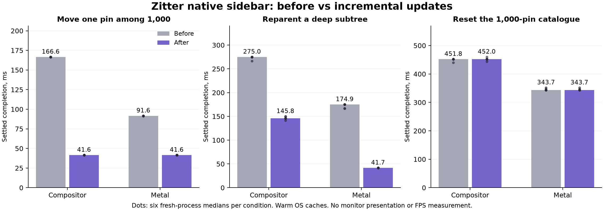

# Incremental native sidebar: performance and validation

This change updates retained pin trees in place instead of detaching every pin,
folder group and normal tab after a local catalogue edit. It leaves unrelated
native adapters attached to the window, preserving their layout caches, focus
and accessibility membership.

The local-edit fixture shows a repeatable improvement in both synchronous work
and settled UI completion. On the compositor backend, moving one pin saves about
57 ms in the handler and 125 ms through completion. Browser CPU for the entire
four-operation fixture falls by about 58%; Metal falls by about 70%. This is a
reduction in work, not just deferring layout outside the synchronous endpoint.
Ordinary tab/palette completion and complete catalogue reset remain effectively
unchanged. The benefit is concentrated in retained-tree edits, not all browsing.



### Local edits: synchronous dispatch

| Operation | Compositor before → after, ms | Paired change, 95% interval | Metal before → after, ms | Paired change, 95% interval |
|---|---:|---:|---:|---:|
| Move one leaf | 64.46 → 7.34 | -88.61% [-88.78%, -88.05%] | 64.24 → 8.21 | -87.18% [-87.44%, -86.75%] |
| Reparent a folder and its children | 65.43 → 7.91 | -87.87% [-87.96%, -87.41%] | 65.41 → 8.81 | -86.55% [-86.68%, -85.96%] |
| Delete one branch | 62.59 → 7.64 | -87.81% [-87.92%, -87.42%] | 62.61 → 8.54 | -86.29% [-86.51%, -85.92%] |
| Restore catalogue after local edits | 67.38 → 10.52 | -84.42% [-84.53%, -83.77%] | 67.28 → 12.00 | -82.18% [-82.39%, -81.77%] |

### Local edits: settled completion

| Operation | Compositor before → after, ms | Paired change, 95% interval | Metal before → after, ms | Paired change, 95% interval |
|---|---:|---:|---:|---:|
| Move one leaf | 166.60 → 41.59 | -75.03% [-75.06%, -75.03%] | 91.60 → 41.60 | -54.58% [-54.59%, -54.58%] |
| Reparent a folder and its children | 166.64 → 49.96 | -70.02% [-70.73%, -70.02%] | 91.64 → 41.63 | -54.57% [-54.57%, -54.57%] |
| Delete one branch | 162.45 → 108.34 | -33.27% [-34.98%, -30.26%] | 91.63 → 41.63 | -54.57% [-54.58%, -54.56%] |
| Restore catalogue after local edits | 166.66 → 116.64 | -30.02% [-31.68%, -27.50%] | 91.65 → 49.96 | -45.49% [-46.50%, -45.48%] |

The wide restoration recreates roughly 42 deleted pins and restores the moved
edges while retaining the rest of the 1,000-pin catalogue. It is distinct from
the nearly complete reset below. The percentages are paired process changes,
so they need not equal the ratio of the two displayed aggregate medians.

### Deep subtree and bulk reset

| Operation | Compositor before → after, ms | Paired change, 95% interval | Metal before → after, ms | Paired change, 95% interval |
|---|---:|---:|---:|---:|
| Restore: synchronous | 318.64 → 318.86 | +0.12% [+0.04%, +0.90%] | 318.38 → 318.24 | -0.10% [-0.31%, -0.02%] |
| Restore: settled | 451.83 → 451.96 | +0.03% [-0.00%, +1.35%] | 343.71 → 343.69 | -0.01% [-1.16%, +1.09%] |
| Reparent deep subtree: synchronous | 141.82 → 11.20 | -92.06% [-92.22%, -91.92%] | 141.90 → 11.22 | -92.07% [-92.15%, -92.00%] |
| Reparent deep subtree: settled | 274.99 → 145.85 | -46.22% [-47.72%, -45.39%] | 174.94 → 41.68 | -76.17% [-76.21%, -75.00%] |
| Delete deep subtree: synchronous | 11.16 → 9.83 | -12.08% [-14.52%, -11.11%] | 11.09 → 9.71 | -12.46% [-13.96%, -11.48%] |
| Delete deep subtree: settled | 41.63 → 33.32 | -19.96% [-20.02%, -9.98%] | 33.32 → 33.34 | +0.06% [-0.16%, +0.68%] |

The compositor reset handler has a small positive paired interval, but its
aggregate difference is only about 0.22 ms; settled reset completion is unchanged
within the paired intervals. The Metal reset handler differs by about −0.14 ms.
Initial creation/reset still costs roughly 319 ms synchronously and remains a
substantial UI-thread bottleneck. Keeping a bulk path avoids the much larger
reset regression observed while developing an entirely live projection.

### Ordinary interaction and confirmation

| Operation | Compositor before → after, ms | Paired change, 95% interval | Metal before → after, ms | Paired change, 95% interval |
|---|---:|---:|---:|---:|
| Select tab, settled | 16.58 → 16.57 | -0.01% [-0.04%, +0.03%] | 16.57 → 16.57 | -0.01% [-0.11%, +0.18%] |
| Toggle folder, settled | 16.47 → 16.46 | +0.02% [-0.12%, +0.07%] | 16.45 → 16.45 | -0.01% [-0.10%, +0.33%] |
| Open palette, synchronous | 8.79 → 9.54 | +5.70% [+1.40%, +10.62%] | 9.38 → 9.74 | +3.78% [-7.16%, +8.51%] |
| Open/type/close palette, settled | 91.61 → 91.62 | +0.07% [-0.07%, +8.97%] | 91.65 → 91.68 | +0.03% [-0.04%, +4.48%] |
| Whole iteration, settled | 125.01 → 125.04 | +0.04% [-0.04%, +6.59%] | 125.06 → 125.06 | -0.01% [-0.06%, +2.76%] |

The first compositor run shows a 0.75 ms difference in the palette-open call
(paired +5.70%, interval [+1.40%, +10.62%]). An independent, separately retained
six-pair compositor confirmation did not reproduce that result: 9.74 → 9.83 ms,
paired +0.92% [−0.39%, +1.70%]. The complete palette cycle is 91.58 → 91.58 ms in
the confirmation, with its interval crossing zero. Both series are retained;
the first result was not discarded or replaced. No repeatable end-to-end
ordinary-interaction gain is detected.

### Browser resources

| Fixture | Backend | CPU per iteration before → after, ms | Paired CPU change | Post-workload footprint before → after, MiB |
|---|---|---:|---:|---:|
| Local edits | Compositor | 594.85 → 247.61 | -58.38% | 101.37 → 100.81 |
| Local edits | Metal | 296.63 → 88.01 | -70.38% | 113.06 → 112.77 |
| Deep/bulk | Compositor | 715.63 → 584.80 | -18.19% | 99.92 → 99.03 |
| Deep/bulk | Metal | 506.05 → 378.88 | -25.09% | 217.74 → 217.09 |
| Ordinary | Compositor | 47.84 → 46.79 | -1.90% | 118.47 → 118.24 |
| Ordinary | Metal | 47.81 → 45.98 | -4.40% | 261.13 → 263.31 |

CPU readings include the whole browser process, across its threads, and all
operations in that fixture iteration. Footprints are post-workload values, not
peak or total browser RAM. Small footprint differences do not establish a
meaningful memory saving.

### Remaining work: profile evidence

Requested sampling is eight seconds at 1 ms intervals per version, separately
from latency runs. The profiler yielded different main-thread sample counts;
these are not a speed ratio. The workload remained running throughout sampling.
Percentages below are inclusive wall-stack envelopes with overlapping ancestors,
not a partition of CPU cycles and not additive.

| Main-thread envelope | Before | After |
|---|---:|---:|
| RebuildTabs | 37.9% | 8.9% |
| Add/remove/reorder views | 29.0% | 1.0% |
| Native layout | 3.8% | 8.0% |
| Painting | 46.3% | 58.3% |
| Text layout | 43.1% | 53.6% |
| Model-to-native graph adapter | 1.8% | 4.2% |
| Rust graph reconciliation | 1.7% | 3.9% |
| Selected kernel waits | 10.8% | 18.6% |

Main-thread samples: 5,286 before and 1,298 after.

The hierarchy envelope drops from 29% to about 1% of main-thread wall samples.
Painting and text layout dominate the remaining active stacks. Their larger
relative share does not mean they became slower: total browser CPU decreased
substantially. Model planning/inventory remains global, but its sample share is
much smaller than text/paint. The next candidates are narrower paint damage and
text caching on the compositor, and native-row virtualization for initial large
catalogues. These profiles do not establish physical frame presentation latency.


## Implementation and limits

The Rust graph remains authoritative for logical identities, hierarchy and
presentation. Before patching, the native projection inventories the actual
rows and groups and checks ownership, parent edges, holder shape and child
counts. A stale or damaged adapter takes the existing full repair path.

The projection reuses attached holders and groups, reparents only changed units,
and carries an existing folder's children with its group. Same-widget transfers
use Views' direct child transfer API, preserving widget membership and theme
caches; input in the moved subtree is explicitly cancelled. It moves surviving
children out of deleted ancestors before removing whole obsolete subtree roots.
Sibling order is reconciled after deletions, avoiding needless reorder operations
for rows whose indices simply shifted. Pin-only updates no longer rebuild the
unchanged normal-tab column. Metadata refresh touches changed rows; indentation
changes invalidate geometry only when the actual padding changes. Indentation
is capped at eight levels, so deeper logical moves often keep the same padding.

A catalogue with more new nodes than surviving nodes uses the existing offline
construction path and attaches the completed tree once. Initial population,
clearing the whole tree, identity/kind replacement, damaged adapters and pinned
Split View anchors also retain the full path. The incremental path uses normal posted layout delivery for ordinary edits.
It resolves layout immediately only when a moved focused row must be scrolled
back into view. Both synchronous dispatch and settled completion are measured.

This is not virtualization or an entirely incremental model. Rust planning,
snapshot generation, native inventory and some scene/context refreshes still
visit the full catalogue. Initial creation of a large catalogue still creates
all its native rows. Browser security services and scoped action validation are
unchanged.

## Method

- Apple M3 Pro, 12 logical CPUs, 36 GiB RAM, macOS 27.0.1.
- Before: `92d4395`, with only the same opt-in `PerformanceSidebarSubtree`
  benchmark added. Its source was reconstructed and checked against the frozen
  staging manifest. After: `bfd69a1`, the final subtree projection changes.
- Both native binaries use the same pinned Chromium, SDK, compiler, arm64
  non-component Release configuration, ThinLTO and Chromium PGO. Binary SHA-256
  receipts and complete product-source manifests identify the exact artifacts.
- Final builds use an isolated worktree and private output cloned with APFS
  copy-on-write. Product objects were discarded and rebuilt from the isolated
  sources, preventing concurrent assistant changes from entering the candidate.
  The prepared upstream Chromium trees are shared read-only.
- Six fresh-process repetitions per version/backend, alternating order, with
  private profiles, warm OS caches and three excluded warmup iterations.
  Compositor and Metal raster configurations are measured separately.
- A build-process monitor waits for compilation/linking to stop before a case.
  If another build starts during a case, the entire attempt is discarded and
  restarted after the build is idle; exclusion reasons are recorded. Native
  stack sampling runs separately and is excluded from latency comparisons.
- The local-edit fixture has 1,000 pins across 24 folders. It moves one leaf,
  reparents a folder with approximately 41 children, deletes another such
  branch, then restores the catalogue. Each process measures 20 iterations and
  eight endpoints. The existing ordinary interaction fixture uses 20 local
  tabs, one folder and 40 iterations. The deep bulk fixture uses 1,000 pins,
  a 32-folder chain and 10 iterations.
- The primary latency comparison has 72 processes and 14,160 retained timing
  samples. The independent palette confirmation adds 12 processes and 4,320
  samples, for 84 processes and 18,480 timing samples in total. Resource readings cover the browser process only, excluding renderer,
  GPU and WindowServer processes. Other desktop applications remain running.

Tables use medians of six process medians. Paired percentage changes and
bootstrap intervals use processes as resampling units, rather than treating
correlated iterations as independent experiments. Intervals describe this
machine without a multiple-comparison correction. Settled completion includes
persistence and draining posted UI/layout work; neither endpoint measures
physical input-to-photon latency or monitor FPS.

## Validation

Native regression coverage includes adapter
identity and actual attachment observations, unchanged branches and tabs, focus,
folder deletion with surviving children, bounded live mutations during a large
reset, failed persistence rollback, stale input, detached adapters and Split View.

The final candidate passes 40 native integration tests and 121 Python tests.
The explicit Metal pin suite passes 9/10. Its strict
`PinModelFolderRenameAndCollapseUseCurrentRustTitle` assertion times out on the
same Metal-text predicate in the frozen baseline as well as the candidate.
The assertion was retained. Metal timing measurements are not full Metal visual
acceptance; this existing presentation/test discrepancy is unresolved.

The full GN include check reports 15 inherited dependency errors in printing,
extensions, password import, authentication, media preferences and importer
localization includes. No new include error is introduced by this change. The
normal Release build succeeds; the complete GN include check is not green.

The concrete bundle audit identifies 343 components and zero unmatched binaries.
Its notices are identical to the notices sealed into the signed app. The audit
retains 21 metadata diagnostics; it is not a complete compliance certificate.

The local Developer ID app is packaged at
`build/ZitterIncrementalSidebar.app`. Its strict deep signature check and
packaged navigation/new-tab/Split View/clean-exit smoke pass. This is a local
build, with no public release tag or notarization submission. The app was also
launched with an owned isolated profile; a final manual window check was blocked
by the locked Mac, so it is not counted as visual acceptance.


## Reproduction

Build and freeze the baseline and candidate `zitter_prototype` binaries using the
same optimized output configuration and the identical benchmark method. Preserve
binary source receipts before switching sources. For each case:

```sh
python3 tools/benchmark_product_boundary.py \
  --before /path/to/zitter_prototype_subtree_before \
  --after /path/to/zitter_prototype_subtree_after \
  --test subtree --iterations 20 --pins 1000 --rounds 6
```

Use `--test interaction --iterations 40` for ordinary interaction, and
`--test boundary --iterations 10` for the deep bulk fixture. Keep compilation,
profiling and other test processes out of the timing window.

## Artifacts

- [Machine-readable comparisons, source receipts and validation](benchmarks/sidebar-subtree-2026-11-06.json).
- [Raw process runs and retained timing samples](benchmarks/sidebar-subtree-2026-11-06.samples.json.gz), including both ordinary-interaction series.
- [Native stack profiles and their analysis](benchmarks/sidebar-subtree-2026-11-06.profiles.json.gz).
- [PNG chart](benchmarks/sidebar-subtree-2026-11-06.png) and [SVG chart](benchmarks/sidebar-subtree-2026-11-06.svg).

The summary records the rejected attempts caused by concurrent build/test/signing
activity; their timings are excluded as entire attempts, not selected trials.
A private output and source manifests keep concurrent assistant changes out of
both the candidate and final artifact identity. Source and build metadata
identify the measured extraction independently of subsequent main changes.

